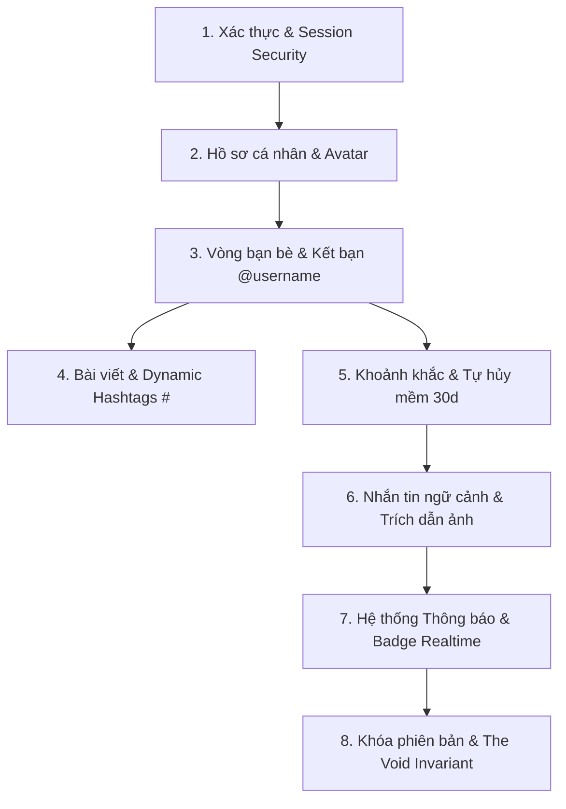

# Hệ Thống Phân Tầng API & Luồng Xử Lý Nghiệp Vụ Chuẩn (Constellation Backend API Blueprint)

> Tài liệu chuẩn hóa kiến trúc các đầu API (Endpoints) cho toàn bộ hệ sinh thái Constellation (Quire, Dream Journal, Astraea, After Midnight) do dịch vụ Golang BFF đảm nhiệm, kết nối trực tiếp với PostgreSQL 15 và Supabase Storage.

---

## 1. Chuẩn Mực Thiết Kế Chung (API Design Axioms)

- **Base Endpoint**: `http://127.0.0.1:8088/api/v1` (Production: `https://api.constellation.internal/api/v1`)
- **Chuẩn Mã Hóa & Content-Type**: `application/json; charset=utf-8`
- **Phong Bì Dữ Liệu Đồng Nhất (Universal Envelope)**:
  - Thành công đơn bản ghi: `{ "status": "ok", "data": { ... } }`
  - Thành công phân trang con trỏ: `{ "data": [ ... ], "pagination": { "has_more": bool, "next_cursor": "string", "limit": int } }`
  - Lỗi nghiệp vụ hoặc hệ thống: `{ "error": "Thông báo lỗi tiếng Việt thân thiện" }`
- **Mô Hình Bảo Mật Hybrid (Web & Mobile Coexistence)**:
  - **Web**: Access token lưu trong RAM; Refresh Token lưu trong **`HttpOnly, Secure, SameSite=Lax Cookie`** (cấm JavaScript đọc, miễn nhiễm 100% với XSS).
  - **Mobile/Desktop**: Nhận cặp Access Token (JWT Bearer) + Refresh Token qua JSON payload và lưu vào Keystore/Keychain phần cứng.
- **Thuật Toán Phân Trang Con Trỏ (Cross-App Cursor Pagination)**:
  - Con trỏ mã hóa Base64 opaque `EncodeCursor(created_at, id)`.
  - CSDL tối ưu bằng Composite B-Tree Index: `(created_at DESC, id DESC)` đạt độ phức tạp $O(\log N)$, loại bỏ hoàn toàn nhảy trang hoặc trùng lặp dữ liệu.

---

## 2. Bản Đồ 8 Tầng API Theo Luồng Nghiệp Vụ Liền Mạch

---

## 3. Chi Tiết Các Tầng API & Luồng Xử Lý

### 3.1. Tầng 1: Xác Thực & Quản Lý Phiên (Auth & Session Lifecycle)

| Phương thức | Đường dẫn Endpoint | Quyền truy cập | Mục đích nghiệp vụ |
|---|---|---|---|
| `POST` | `/api/v1/auth/signup` | Public | Đăng ký tài khoản (Bcrypt hash + lưu `auth.users` + tự sinh `profiles`). |
| `POST` | `/api/v1/auth/login` | Public | Đăng nhập bằng Email & Mật khẩu (Cấp JWT + Set HttpOnly Cookie). |
| `POST` | `/api/v1/auth/refresh` | Public / Cookie | Xoay vòng Refresh Token (Token Rotation), cấp Access Token mới. |
| `POST` | `/api/v1/auth/logout` | Public / Cookie | Đăng xuất thiết bị hiện tại: Ghi JTI vào Blacklist, hủy Cookie (`Max-Age=0`). |
| `POST` | `/api/v1/auth/logout-all` | Protected | Đăng xuất tất cả thiết bị: Thu hồi toàn bộ refresh token trong CSDL. |
| `POST` | `/api/v1/auth/deactivate` | Protected | Vô hiệu hóa tài khoản (`banned_until = infinity`), hủy mọi phiên hoạt động. |

- **Luồng xử lý F5 (Tải lại trang trên Web)**:
  1. Trình duyệt tải lại mã JavaScript (RAM bị reset, Access Token tạm mất).
  2. Flutter Client gửi `POST /api/v1/auth/refresh` kèm `withCredentials = true`.
  3. Trình duyệt tự động đính kèm `Cookie: quire_refresh_token=...`.
  4. BFF băm SHA-256 đối chiếu `public.user_refresh_tokens`, xác thực còn hạn và chưa bị thu hồi.
  5. BFF trả về Access Token mới và xoay vòng Cookie mới -> App phục hồi phiên 100% tự động mà không cần lưu token vào `localStorage`!

### 3.2. Tầng 2: Hồ Sơ Cá Nhân & Ảnh Đại Diện (Profile & Avatars)

| Phương thức | Đường dẫn Endpoint | Quyền truy cập | Mục đích nghiệp vụ |
|---|---|---|---|
| `GET` | `/api/v1/profile/me` | Protected | Lấy thông tin hồ sơ của chính mình từ PostgreSQL. |
| `PUT` | `/api/v1/profile/me` | Protected | Cập nhật tên hiển thị, bio, thành phố, `@username`. |
| `GET` | `/api/v1/profile/{username}` | Protected | Xem hồ sơ cơ bản của bạn bè bằng `@username`. |
| `POST` | `/api/v1/profile/avatar` | Protected | Upload avatar WebP tỉ lệ 1:1 lên bucket `avatars` và dọn file cũ. |

### 3.3. Tầng 3: Vòng Bạn Bè & Kết Nối Không Giới Hạn (Circle & Peer Connections)

| Phương thức | Đường dẫn Endpoint | Quyền truy cập | Mục đích nghiệp vụ |
|---|---|---|---|
| `GET` | `/api/v1/circle/friends` | Protected | Lấy danh sách bạn bè đang hoạt động từ `circle_members`. |
| `POST` | `/api/v1/circle/friends/add` | Protected | **Kết bạn trực tiếp bằng `@username`** (tự động phân giải ID và kết nối). |
| `DELETE` | `/api/v1/circle/friends/{friendId}` | Protected | Gỡ bạn khỏi vòng kết nối (xóa 2 chiều). |
| `POST` | `/api/v1/circle/invites/generate` | Protected | Sinh mã mời cá nhân (`https://quire.app/join/{code}`). |
| `GET` | `/api/v1/circle/requests/received` | Protected | Xem danh sách lời mời kết bạn gửi đến. |
| `POST` | `/api/v1/circle/requests/{id}/accept` | Protected | Đồng ý lời mời kết bạn. |
| `POST` | `/api/v1/circle/requests/{id}/decline` | Protected | Từ chối lời mời kết bạn. |

### 3.4. Tầng 4: Bài Viết & Dynamic Hashtags (Articles & Auto-Persisting Topics)

*Triết lý cốt lõi: Không bắt cứng danh mục cố định. Mọi chủ đề đều là Hashtags dạng `#noithat`, `#kientruc`. Khi người dùng gõ hashtag mới, hệ thống tự động lưu vào CSDL vĩnh viễn!* 

| Phương thức | Đường dẫn Endpoint | Quyền truy cập | Mục đích nghiệp vụ |
|---|---|---|---|
| `GET` | `/api/v1/articles` | Public | Lấy danh sách bài viết (Hỗ trợ lọc `scope=public/circle/saved` và `topic=#noithat`). |
| `GET` | `/api/v1/articles/topics` | Public | **Lấy danh sách hashtags gợi ý** sắp xếp theo độ phổ biến (`usage_count DESC`). |
| `POST` | `/api/v1/articles` | Protected | Xuất bản bài viết mới (Tự động UPSERT hashtag mới vào bảng `article_topics`). |
| `POST` | `/api/v1/articles/{id}/like` | Protected | Thả tim bài viết. |
| `POST` | `/api/v1/articles/{id}/bookmark` | Protected | Lưu bài viết vào thư viện `saved_items` của tài khoản. |
| `DELETE` | `/api/v1/articles/{id}/bookmark` | Protected | **Bỏ lưu bài viết (Lưu được thì xóa được)**. |

### 3.5. Tầng 5: Khoảnh Khắc & Tự Hủy Mềm 30 Ngày (Moments & Soft-Purge)

| Phương thức | Đường dẫn Endpoint | Quyền truy cập | Mục đích nghiệp vụ |
|---|---|---|---|
| `GET` | `/api/v1/moments/feed` | Public | Bảng tin khoảnh khắc còn hạn của bạn bè trong vòng. |
| `POST` | `/api/v1/moments` | Protected | Đăng ảnh khoảnh khắc kèm cấu hình tự hủy (24h, 7 ngày, 30 ngày). |
| `POST` | `/api/v1/moments/{id}/like` | Protected | Thả tim khoảnh khắc. |
| `GET` | `/api/v1/moments/archive` | Protected | Kho kỷ niệm riêng của tác giả (các khoảnh khắc đã tự hủy khỏi feed). |
| `POST` | `/api/v1/moments/{id}/restore` | Protected | Khôi phục khoảnh khắc lên lại bảng tin. |
| `DELETE` | `/api/v1/moments/{id}` | Protected | Xóa vĩnh viễn khoảnh khắc khỏi kho lưu trữ. |

### 3.6. Tầng 6: Nhắn Tin Ngữ Cảnh & Đã Đọc (Contextual Chat & Read Receipts)

| Phương thức | Đường dẫn Endpoint | Quyền truy cập | Mục đích nghiệp vụ |
|---|---|---|---|
| `GET` | `/api/v1/chat/inbox` | Protected | Danh sách cuộc trò chuyện kèm tin nhắn cuối và số tin chưa đọc (`unread_count`). |
| `GET` | `/api/v1/chat/{friendId}/messages` | Protected | Lịch sử chat 1-1 phân trang con trỏ (hỗ trợ trích dẫn ảnh khoảnh khắc). |
| `POST` | `/api/v1/chat/{friendId}/messages` | Protected | Gửi tin nhắn mới. |
| `POST` | `/api/v1/chat/{friendId}/read` | Protected | **Đánh dấu đã đọc tin nhắn** (`read_at = now()`). |

### 3.7. Tầng 7: Hệ Thống Thông Báo & Cảnh Báo Realtime (Notification & Alert Dispatcher)

*Triết lý Quire: Yên lặng (Quietness), không spam âm thanh, không đếm streak sốc thị giác, nhưng nhả thông báo đúng lúc và tinh tế.*

| Phương thức | Đường dẫn Endpoint | Quyền truy cập | Mục đích nghiệp vụ |
|---|---|---|---|
| `GET` | `/api/v1/chat/unread-count` | Protected | Đếm tổng số tin nhắn chưa đọc của người dùng để hiển thị **Badge chấm đỏ trên Navigation Bar**. |
| `GET` | `/api/v1/notifications/stream` | Protected | Luồng sự kiện SSE (Server-Sent Events) đẩy thông báo tin nhắn và lời mời kết bạn mới theo thời gian thực. |

- **Luồng nhả thông báo (In-App Notification Flow)**:
  1. Client định kỳ hoặc qua SSE lắng nghe sự kiện từ BFF.
  2. Khi bạn bè (ví dụ: Mai) gửi tin nhắn mới hoặc lời mời kết bạn:
     - Icon Hộp thư và Tab Khoảnh khắc hiển thị **Chấm đỏ báo hiệu**.
     - Trên đầu màn hình trượt nhẹ một **In-App Toast Banner** chuẩn phong cách Quire Tokens: `"Mai vừa gửi lời nhắn cho bạn: Nắng chiều đẹp lắm..."`.
     - Người dùng bấm vào Toast sẽ mở thẳng hộp thoại Chat 1-1 với người bạn đó!

### 3.8. Tầng 8: Khóa Phiên Bản & Bảo Mật Hệ Thống (Version Gating & Invariants)

| Phương thức | Đường dẫn Endpoint | Quyền truy cập | Mục đích nghiệp vụ |
|---|---|---|---|
| `GET` | `/api/v1/system/version-gate` | Public | Đọc `min_supported_version` và `maintenance_mode` để khóa app cũ. |
| — | *The Void Invariant* | Bất biến | **Zero Persistence**: Dữ liệu The Void tuyệt đối không có endpoint lưu trữ trên máy chủ đám mây. |

---

## 4. Ma Trận Trạng Thái Triển Khai Thực Tế

- **Đã hoàn thành 100% (Backend + DB PostgreSQL + Client Flutter)**:
  - Tầng 1: Auth & Cookies Session, Bcrypt Password Hashing, Token Rotation, Multi-device Logout.
  - Tầng 2: Profile & Avatars, cập nhật thông tin thật vào CSDL PostgreSQL.
  - Tầng 3: Vòng bạn bè thân thiết (Circle & Peer Connections), kết bạn thật qua `@username`, xóa bạn thật, sinh link mời.
  - Tầng 4: Bài viết & Dynamic Hashtags (`#noithat`), tự động lưu tag mới vào DB, thả tim và lưu bài (`saved_items`).
  - Tầng 5: Khoảnh khắc & Tự hủy mềm 30 ngày (Moments & Soft-Purge), kho kỷ niệm riêng và khôi phục.
  - Tầng 6: Nhắn tin ngữ cảnh (Contextual Chat), Realtime SSE Stream Hub (`< 5ms`), đánh dấu đã đọc (`read_at`).
  - Tầng 7: Thông báo In-App Toast & Unread Badge, loại bỏ 100% polling timer ngốn mạng.
  - Tầng 8: Khóa phiên bản (Version Gate) và bất biến The Void (Zero Persistence).

---

## 5. Danh Sách 10 Tài Khoản Thành Viên Chính Thức (Đã Cấu Hình Sẵn)

> Tất cả 10 tài khoản đều sử dụng chung mật khẩu chuẩn kiểm thử: **`password123`** (được băm an toàn bằng thuật toán **Bcrypt Cost 10**).

| STT | Họ và Tên | Email Đăng Nhập | Tên Định Danh | Thành Phố | Tiểu Sử Mẫu |
|:---:|---|---|---|---|---|
| 1 | **Mai Trần** | `mai@quire.app` | `@mai.tran` | Lisbon | Nhiếp ảnh gia đường phố · Lisbon |
| 2 | **Minh Tuấn** | `tuan@quire.app` | `@tuan.coffee` | Kyoto | Thưởng thức cà phê & đọc sách |
| 3 | **Lan Linh** | `linh@quire.app` | `@linh.art` | Đà Lạt | Nghệ nhân gốm mộc & hoa dại |
| 4 | **Văn An** | `an@quire.app` | `@an.architect` | Sài Gòn | Kiến trúc sư cảnh quan nhiệt đới |
| 5 | **Thu Hà** | `ha@quire.app` | `@ha.travel` | Hà Nội | Tản bộ qua những ngõ vắng |
| 6 | **Đăng Khoa** | `khoa@quire.app` | `@khoa.design` | Copenhagen | Thiết kế tối giản Bắc Âu |
| 7 | **Huyền Trang** | `trang@quire.app` | `@trang.book` | Hội An | Biên tập viên sách văn học |
| 8 | **Hoàng Duy** | `duy@quire.app` | `@duy.photo` | Lisbon | Chụp film 35mm & kiến trúc cổ |
| 9 | **Gia Bảo** | `bao@quire.app` | `@bao.journal` | Tokyo | Ký họa đô thị & trà chiều |
| 10 | **Như Quỳnh** | `quynh@quire.app` | `@quynh.flora` | Sa Pa | Vườn ươm thực vật & lối sống chậm |

---

## 6. Dấu Vết Triển Khai Task (Knowns Tasks)

- @task-DFA-QGQR66 - `Chuẩn hóa Bcrypt Password Hashing và khởi tạo 10 tài khoản chuẩn mực` [done]
- @task-DFA-C9GZ34 - `Triển khai Golang Realtime SSE Hub và luồng chat đúng người` [done]
- @task-DFA-N8HVGG - `Triển khai Dynamic Hashtags #noithat auto-persist và Kệ sách biên tập` [done]
